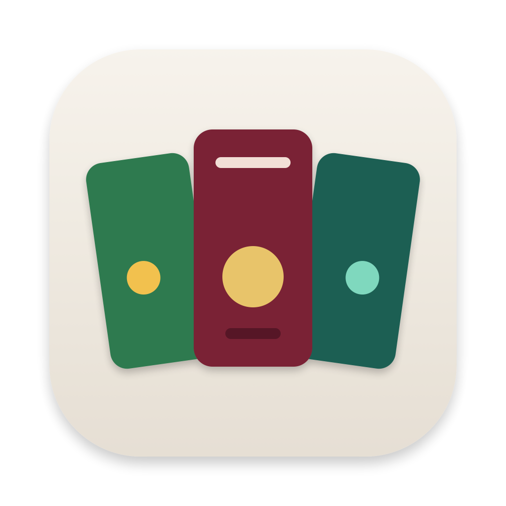
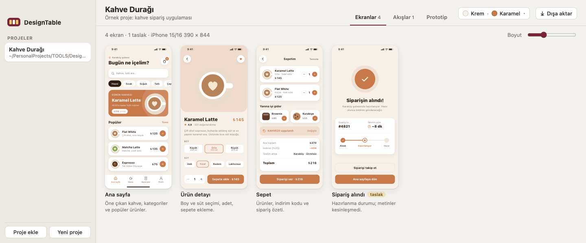
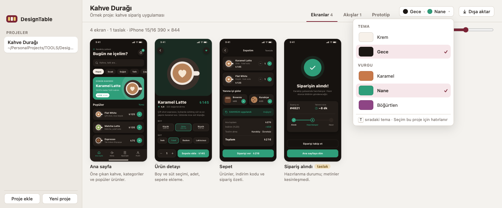
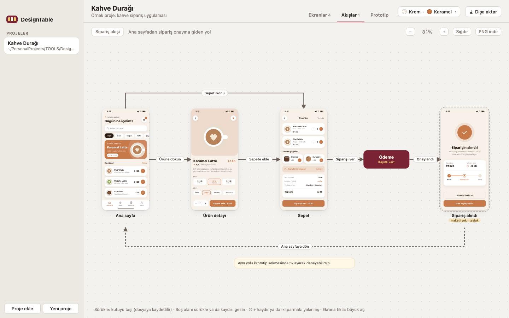
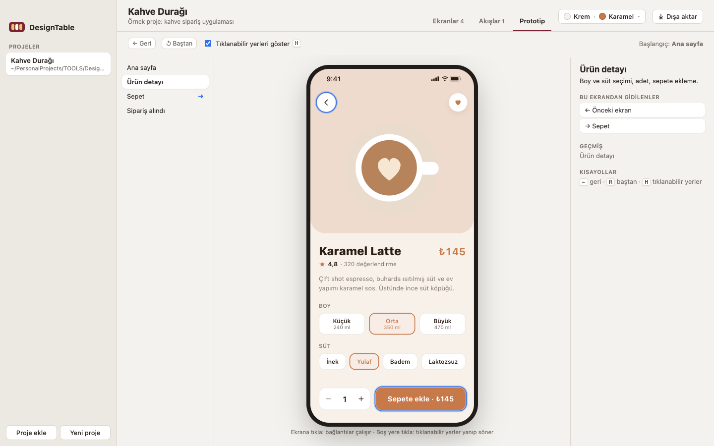

<p align="center">
  
</p>

<h1 align="center">DesignTable</h1>

<p align="center">
  A lightweight desktop app for <b>code-based design projects</b>: screens in HTML/CSS, themes as CSS variables,<br>
  flow diagrams and clickable prototypes, all in one window.<br><br>
  <b>English</b> · <a href="README.tr.md">Türkçe</a>
</p>



DesignTable is not a drawing tool. Screens are written as plain HTML/CSS files, by you or by an AI coding agent.
DesignTable lays them out, switches themes instantly, draws the flows between screens, plays them as a clickable prototype
and exports PNGs. It is free, works offline and needs no account.

> The app's interface is in Turkish. Project files are plain HTML, CSS and JSON, so every screen also opens in a browser.

## Features

- **Screens:** every screen in a grid with a size slider. Click a screen for a large view and browse with ← →.
- **Themes and variants:** a project defines variable groups, such as *Theme: Cream / Night* and *Accent: Caramel / Mint / Blackberry*.
  Pick an option and every screen, flow and prototype updates at once. `T` cycles through themes. The choice is remembered per project.
- **Flows:** screen thumbnails, state boxes and auto-routed right-angle arrows. Boxes can be dragged and their positions are written back to the JSON file.
- **Prototype:** screens at real size and clickable. Links are `data-hedef` attributes in the HTML. Back, restart, tappable-area highlight,
  timed auto-advance and history are built in.
- **Components:** an optional free-size component page per project.
- **Export:** the project as a zip (optionally with PNGs), all screens as PNGs, a single screen at 1x/2x/3x, and flows as PNG.
- **Live reload:** when a project file changes on disk (for example, an AI agent edits a screen), the view refreshes by itself.
- **Command line:** render screens, flows and UI screenshots without opening a window. This lets scripts and AI agents check their own work.

**Theme menu:** one click switches every screen to another theme and accent colour.



**Flows:** screens, state boxes and arrows, drawn from a small JSON file.



**Prototype:** real-size, clickable screens with tappable areas highlighted.



## Getting started

You need [Node.js](https://nodejs.org) (20 or newer) and npm.

```bash
git clone https://github.com/oguzdavarci/DesignTable.git
cd DesignTable
npm install
npm start
```

To see the example, click **Proje ekle** (Add project) and choose [`examples/coffee-shop`](examples/coffee-shop).
**Yeni proje** (New project) creates an empty project from [`template/`](template).

To package a macOS app (Apple Silicon):

```bash
npm run paketle
```

The app is written to `dist/DesignTable-darwin-arm64/DesignTable.app`. DesignTable is developed and tested on macOS.

## Project format

A project is an ordinary folder with a `project.json` in it:

```
my-design/
  project.json        name, device size, variable groups (themes), list of screens and flows
  shared/styles.css   styles shared by all screens; default variable values
  shared/*.js         (optional) shared components, e.g. custom elements
  screens/*.html      one file per screen
  flows/*.json        one file per flow
  components.html     (optional) free-size component page
```

Screens never contain colour codes, only `var(--Role)`. Each option of a variable group supplies the values,
and DesignTable injects them into every screen. Full reference (in Turkish): [docs/PROJECT-FORMAT.md](docs/PROJECT-FORMAT.md).
A complete example: [examples/coffee-shop](examples/coffee-shop).

## Working with AI coding agents

DesignTable is built for a workflow where an AI coding agent writes and edits the screen files while you watch the result live.
[docs/PROJECT-FORMAT.md](docs/PROJECT-FORMAT.md) includes a working note for agents. The command line lets an agent render its own output and look at it:

```bash
# all screens as PNG ("hepsi" = all), at 2x
npx electron . --png examples/coffee-shop hepsi out/ --olcek=2
# one flow as PNG
npx electron . --akis-png examples/coffee-shop order-flow out/flow.png
# a screenshot of the app itself, on a given tab and theme
npx electron . --arayuz-goruntusu out/ui.png --proje=examples/coffee-shop --sekme=akislar --tema=gece
```

## Project structure

| Path | Contents |
|---|---|
| `src/main.js` | Main process: window, project registry, `dt://` protocol (theme injection), file watching, PNG and zip export, command line |
| `src/preload.js` | API between the interface and the main process |
| `src/ui/` | Interface: plain HTML/CSS/JS with no build step. `flow-renderer.js` draws the flows |
| `template/` | Empty project copied by **Yeni proje** |
| `examples/coffee-shop/` | Example project used in the screenshots |
| `build/` | App icon. `icon-source/icon.html` is its source |

The project list is stored in `~/Library/Application Support/DesignTable/projects.json`.

## Built with

[Electron](https://www.electronjs.org) and [JSZip](https://stuk.github.io/jszip/). The interface is plain HTML, CSS and JavaScript with no framework and no build step.

## License

[MIT](LICENSE)
