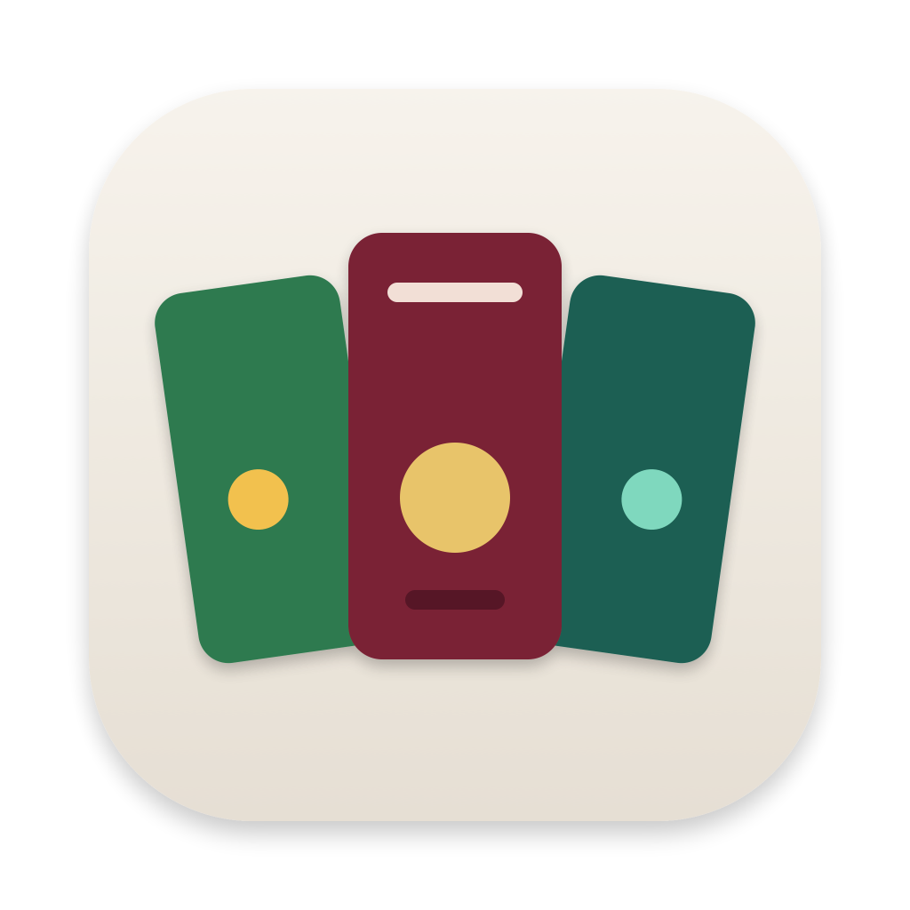
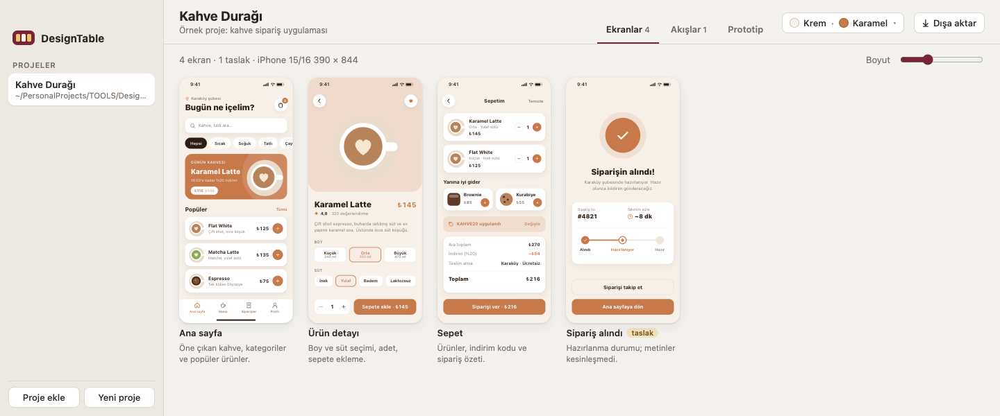
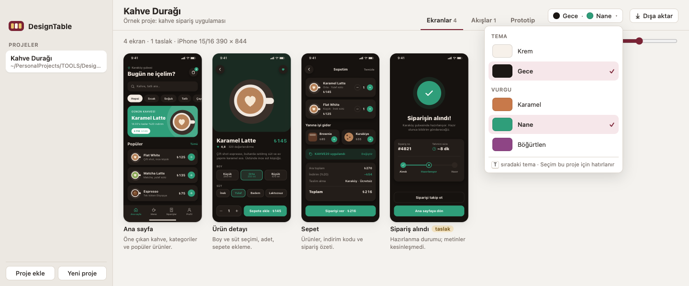
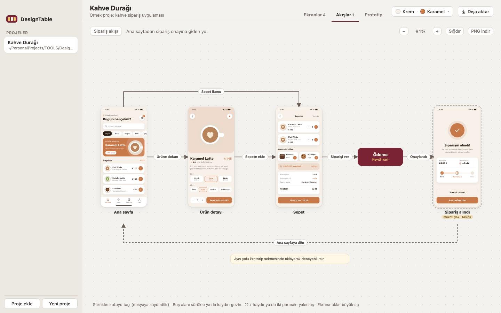
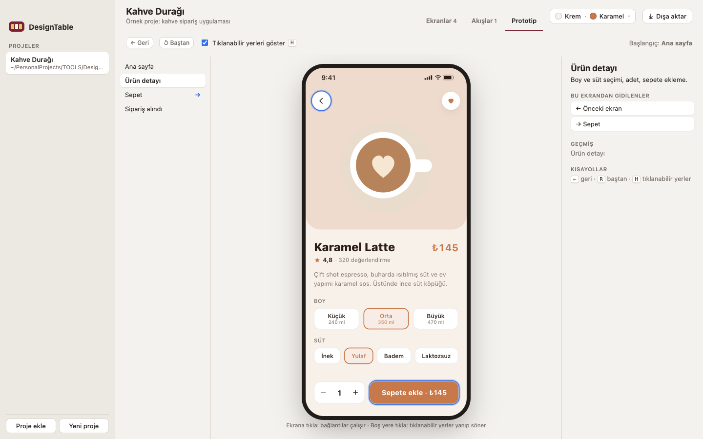

<p align="center">
  
</p>

<h1 align="center">DesignTable</h1>

<p align="center">
  <b>Kodla yazılan tasarım projeleri</b> için sade bir masaüstü aracı: HTML/CSS ekranlar, CSS değişkenli temalar,<br>
  akış şemaları ve tıklanabilir prototip tek pencerede.<br><br>
  <a href="README.md">English</a> · <b>Türkçe</b>
</p>



DesignTable bir çizim aracı değildir. Ekranlar düz HTML/CSS dosyaları olarak yazılır; bunları sen ya da bir yapay zeka
kodlama ajanı yazar. DesignTable ekranları düzenli gösterir, temaları anında değiştirir, ekranlar arası akışları çizer,
prototip olarak oynatır ve PNG olarak dışa aktarır. Ücretsizdir, internet ve hesap gerektirmez.

## Ne yapar

- **Ekranlar:** bütün ekranlar ızgarada, boyut kaydırıcısıyla. Ekrana tıklayınca büyük görünüm açılır, ← → ile gezilir.
- **Temalar ve seçenekler:** proje değişken grupları tanımlar, ör. *Tema: Krem / Gece* ve *Vurgu: Karamel / Nane / Böğürtlen*.
  Bir seçenek seçilince bütün ekranlar, akışlar ve prototip anında değişir. `T` tuşu sıradaki temaya geçer. Seçim her proje için hatırlanır.
- **Akışlar:** ekran küçük resimleri, durum kutuları ve kendiliğinden çizilen dik açılı oklar. Kutular sürüklenebilir, konumlar JSON dosyasına yazılır.
- **Prototip:** ekranlar gerçek boyutta ve tıklanabilir. Bağlantılar HTML'deki `data-hedef` öznitelikleridir. Geri, baştan,
  tıklanabilir yerleri gösterme, süreli otomatik geçiş ve geçmiş hazırdır.
- **Bileşenler:** her proje için isteğe bağlı, serbest boyutlu bir bileşen sayfası.
- **Dışa aktarma:** projeyi zip olarak (isteğe bağlı PNG'lerle), bütün ekranları PNG olarak, tek ekranı 1x/2x/3x ve akışları PNG olarak.
- **Canlı yenileme:** proje dosyaları diskte değişince (ör. bir yapay zeka ajanı ekranı düzenleyince) görünüm kendiliğinden yenilenir.
- **Komut satırı:** pencere açmadan ekran, akış ve arayüz görüntüsü alır. Betikler ve yapay zeka ajanları kendi işlerini böyle kontrol eder.

**Görünüm menüsü:** tek tıkla bütün ekranlar başka bir temaya ve vurgu rengine geçer.



**Akışlar:** ekranlar, durum kutuları ve oklar küçük bir JSON dosyasından çizilir.



**Prototip:** gerçek boyutta, tıklanabilir ekranlar; tıklanabilir yerler işaretli.



## Başlarken

[Node.js](https://nodejs.org) (20 ya da üstü) ve npm gerekir.

```bash
git clone https://github.com/oguzdavarci/DesignTable.git
cd DesignTable
npm install
npm start
```

Örneği görmek için **Proje ekle**'ye tıkla ve [`examples/coffee-shop`](examples/coffee-shop) klasörünü seç.
**Yeni proje**, [`template/`](template) klasöründen boş bir proje oluşturur.

macOS uygulaması olarak paketlemek (Apple Silicon):

```bash
npm run paketle
```

Uygulama `dist/DesignTable-darwin-arm64/DesignTable.app` olarak çıkar. DesignTable macOS'ta geliştirilip denenmiştir.

## Proje biçimi

Proje, içinde `project.json` olan sıradan bir klasördür:

```
my-design/
  project.json        ad, cihaz ölçüsü, değişken grupları (temalar), ekran ve akış listesi
  shared/styles.css   bütün ekranların ortak stili; varsayılan değişken değerleri
  shared/*.js         (isteğe bağlı) ortak bileşenler, ör. özel etiketler
  screens/*.html      her ekran bir dosya
  flows/*.json        her akış bir dosya
  components.html     (isteğe bağlı) serbest boyutlu bileşen sayfası
```

Ekranlarda renk kodu yazılmaz, hep `var(--Rol)` kullanılır. Değişken grubunun her seçeneği değerleri verir,
DesignTable bunları her ekrana ekler. Biçimin tamamı: [docs/PROJECT-FORMAT.md](docs/PROJECT-FORMAT.md).
Eksiksiz bir örnek: [examples/coffee-shop](examples/coffee-shop).

## Yapay zeka kodlama ajanlarıyla çalışma

DesignTable, ekran dosyalarını bir yapay zeka kodlama ajanının yazıp düzenlediği, senin de sonucu canlı izlediğin bir çalışma
düzeni için yapıldı. [docs/PROJECT-FORMAT.md](docs/PROJECT-FORMAT.md) ajanlar için bir çalışma notu içerir. Komut satırı sayesinde
ajan kendi çıktısını görüntüye çevirip bakabilir:

```bash
# bütün ekranlar PNG olarak, 2x
npx electron . --png examples/coffee-shop hepsi out/ --olcek=2
# bir akış PNG olarak
npx electron . --akis-png examples/coffee-shop order-flow out/flow.png
# uygulamanın kendi görüntüsü, belirli sekme ve temada
npx electron . --arayuz-goruntusu out/ui.png --proje=examples/coffee-shop --sekme=akislar --tema=gece
```

## Dosyalar

| Yol | İçerik |
|---|---|
| `src/main.js` | Ana süreç: pencere, proje kaydı, `dt://` protokolü (tema enjeksiyonu), dosya izleme, PNG ve zip, komut satırı |
| `src/preload.js` | Arayüzün ana süreçle konuştuğu API |
| `src/ui/` | Arayüz: derleme adımı olmayan düz HTML/CSS/JS. `flow-renderer.js` akışları çizer |
| `template/` | **Yeni proje** ile kopyalanan boş proje |
| `examples/coffee-shop/` | Ekran görüntülerindeki örnek proje |
| `build/` | Uygulama ikonu. Kaynağı `icon-source/icon.html` |

Proje listesi `~/Library/Application Support/DesignTable/projects.json` dosyasında tutulur.

## Kullanılanlar

[Electron](https://www.electronjs.org) ve [JSZip](https://stuk.github.io/jszip/). Arayüz çerçevesiz ve derleme adımı olmadan düz HTML, CSS ve JavaScript ile yazıldı.

## Lisans

[MIT](LICENSE)
